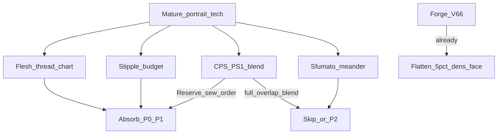

# 调研：人像照片绣成熟方案（可吸收技术）

**日期**：2026-11-14  
**背景**：人像 V6.6 已冻结演示（色准可、细节加压无感）；动物侧已另文调研。本文专扫**人像/写真**成熟技术，标出 Forge **已具备 / 可吸收 / 勿硬搬**。  
**冻结**：人像 V6.6 dens 主逻辑与演示导出 **不动**；本文只定吸收清单，不改代码。

相关：[`路线-照片绣PhotoStitch.md`](路线-照片绣PhotoStitch.md) · [`调研-动物照片绣成熟方案.md`](调研-动物照片绣成熟方案.md) · [`BASELINE.md`](BASELINE.md)

---

## 1. 命名（与动物调研一致）

| 名称 | 人像上的角色 |
|------|----------------|
| **Color PhotoStitch / Brother PS1** | 写真主路径：多色叠层混色 |
| **PhotoFlash / PS2** | 风格化行扫；**不是**人像主解 |
| **Embird Sfumato** | 人像专用商用填法：回纹/密区平填 + 透底 |
| **Forge V6.6** | Bayer 密度短针 stipple + 压平色板 + dens_face；**目标对齐 CPS/PS1，机制更近 stipple/Sfumato 疏密** |

---

## 2. 人像向成熟族系

| 族系 | 代表 | 人像要点 | 与 Forge V6.6 |
|------|------|----------|---------------|
| 叠层混色 PS1 | Brother Photo Stitch 1；Hatch Color PhotoStitch | Image Type=**Photo** 混线；Detail/Run Pitch；脸幅≥约 100×100 mm；**Reserve** 肤/唇/眼；脏灰先绣 | 目标同；**无**真重叠混色、无 Reserve、无专用肤色线表 |
| 压平色板 CPS | Hatch Flatten + 色数/明暗对比 | 少色少剪少针；面积大色默认保留；多数照片 **Flatten 关** 更好，糊图才开 | Forge **已有** `quantize_tones_flatten` + `protect_area_frac≈5%`（对齐「大色保留」） |
| 疏密写真 Sfumato | [Embird Sfumato](https://www.embird.net/machine-embroidery-tutorials/studio-next/sfu_portrait.htm) | 按对象勾脸/发/嘴；Basic→多阴影；**Background=布色** 定疏密；密区改平填；Quality 脸高、衣低；透底 | 理念近 dens；Forge **无**回纹 meander、无布色感知、无分对象 Quality |
| Tonal stipple | Boldbobbin Photostitch | stitches/mm²、Contrast、Fill floor、抠底 | **同族**；旋钮可抄到 CLI |
| 单线艺术 | FaceStitch（TSP/stipple） | 单色连续线肖像 | 开题旁支；**不**做人像主链 |
| 方向场 | embroidery-streamlines | 发丝/衣纹方向 | 发区可选；**肤面慎用** |

### 商用流程共识（人像）

- 清晰高对比；**裁头肩**；背景抠掉或极疏。  
- 线色：灰阶约 5–6；简单彩 7–10；复杂 ≤14–16（≤20）。  
- Brother：先 Candidates / 提对比，再 **Reserve** 肤唇眼；多余灰改缝纫顺序垫底。  
- Hatch：Preview 循环；目标是最少色+最少针+最少剪。  
- Sfumato：分辨率与成绣尺寸绑定（约 100 px/cm）；脸对象单独调 Quality。  
- 成绣：梭织+衬；密针易起皱（工艺，非算法）。

---

## 3. Forge 已对齐 vs 仍缺

### 已具备（不必重做）

| 成熟点 | Forge 落点 |
|--------|------------|
| 大面积色保底（Hatch ≥5%） | `protect_area_frac=0.05` |
| 压平/过量化合并 | V6.6 `quantize_tones_flatten` |
| 脸局部加密 | `dens_face_*` + 结构 dens + CLAHE |
| 多脸 | MediaPipe 并集（V6.6b 保留） |
| 场景分轨 | BG/FG split（`--bg keep`） |
| 侧脸偏红抑制 | FG `dampen_warm_skin`（仅人像） |
| 双预览隐喻 | compare / thick / plan |

### 缺口（人像可吸收，按优先级）

| # | 成熟技术 | 吸收方式 | 风险 |
|---|----------|----------|------|
| P0 | **真线色表 + 肤色专用 chart**（Brother Chart Photo Stitch） | 可选 Madeira/Brother 表 CIEDE2000 贴色；预览按线色而非 sRGB 块 | 需维护色表；不改 dens |
| P0 | **Reserve 色槽**（锁肤/唇/眼/发） | flatten 合并时保护指定 Lab 中心或 ROI 主导色 | UX+小改色板 |
| P1 | **缝纫顺序垫底**（脏灰先绣） | 层序：低 chroma 灰 → 肤 → 五官深色 | 改 emit 排序，易测 |
| P1 | **密度预算 / Contrast / Fill floor**（Boldbobbin；Sfumato Quality） | CLI：`stitches_per_mm2`、`contrast`、脸 Quality↑ 衣↓ | 同族增强，不换引擎 |
| P1 | **脸幅门控**（≥约 100 mm） | meta 警告 / Streamlit 提示；过小不硬抬 dens | 纯流程 |
| P2 | **Image Type=Photo 式弱叠层** | 相邻色在中调允许有限重叠针 | 偏新引擎；易糊/针爆 |
| P2 | **Sfumato meander**（疏区回纹、密区平填） | 仅脸窗 spike，对照 dens_face | 新填法；工作量大 |
| — | PhotoFlash 行扫 / TSP 单线 | 不做人像主吸收 | 风格错配 |
| — | 再抬 max_side / dens_face 细节加压 | V6.6b–d 已证无感 | **冻结** |

---

## 4. 与动物调研的分工

| | 人像（本文） | 动物（[`调研-动物…`](调研-动物照片绣成熟方案.md)） |
|--|--------------|--------------------------------------------------|
| 冻结 | V6.6 演示 | A1 停拧参 |
| 下一默认 | **P0–P1 吸收**（线表/Reserve/序/密度预算） | **A2 streamlines** 单斑块 |
| 同族 stipple | 预算化可增强人像 | 仅当 Boldbobbin bake-off 胜出 |
| 方向场 | 发丝可选，肤面非必须 | 毛发主推 |

---

## 5. 决策与落地

1. **人像 dens 主逻辑仍冻结 V6.6**；不重开 dens_face / max_side 拧参。  
2. **P0 已落地后回退（2026-11-14）** — [`embroideryforge/thread_chart.py`](../embroideryforge/thread_chart.py)：  
   - **人评**：`figure_portrait_p0_smoke` 相对 `*_v66` 蒙一层偏红滤镜，细节无升 → **默认关闭**全图线表硬贴。  
   - 保留可选 `--portrait-p0`：仅 Reserve 肤/唇/眼 + 灰垫底序；线表只写层 meta，**不改写色心**。  
   - 演示基线仍以 **V6.6** 为准。  
3. **P1 密度预算已接通（2026-11-14）**：`--stitches-per-mm2`、`--density-contrast`；`face_width_mm` / `face_width_warn` 写入 meta（&lt;100 mm 不硬抬 dens）。冒烟：`figure_cowboy_dens_budget`。脸/衣分 Quality 仍可选加深。  
4. **延后**：真·PS1 叠层混色、Sfumato meander、PhotoFlash、FaceStitch TSP。  
5. **本机无** Hatch/Brother/Embird；商用截图对照目录建议 `exports/photo_stitch_exp/bakeoff_portrait/`（协议占位，无截图时只写 README）。

---

## 6. 参考链接

- Hatch Color PhotoStitch：https://hatch.embroideryhelp.net/v3/en/OnlineHelp/Automatic/auto-digitize_photos/Auto-digitize_with_Color_PhotoStitch.htm  
- Brother Photo Stitch 说明：https://sewingcraft.brother.eu/en/blog/embroidery/2024/photo-stitch-explained  
- Brother PS1 参数 / Reserve 流程：https://support.brother.com/g/s/hf/htmldoc/ped/im/ped11/en/PED11_EN/pages/06_1879551.html · https://support.brother.com/g/s/hf/htmldoc/ped/im/ped11/en/PED11_EN/pages/06_1883432.html  
- Embird Sfumato 人像教程：https://www.embird.net/machine-embroidery-tutorials/studio-next/sfu_portrait.htm  
- Sfumato 参数：https://www.embird.net/studio/manual/3275par_sfu.htm  
- Boldbobbin Photostitch：https://docs.boldbobbin.com/how-to/auto-digitize-a-photo/  
- FaceStitch（单线）：https://github.com/BhavikDodda/FaceStitch  
