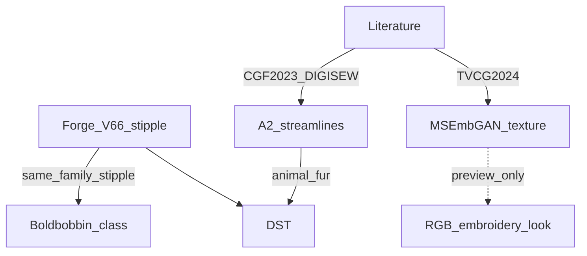

# 调研：照片绣 / 自动数字化相关前沿文献

**日期**：2026-11-14  
**用途**：开题叙事、动物 A2 / 人像后续的学术锚点；**不**要求照抄实现。  
**对照**：[`调研-人像照片绣成熟方案.md`](调研-人像照片绣成熟方案.md) · [`调研-动物照片绣成熟方案.md`](调研-动物照片绣成熟方案.md) · Forge V6.6 dens（stipple）

> 分野：多数「绣纹合成 / style transfer」论文输出**图像纹理**；少数输出**可缝路径**。Forge 目标是 DST，应优先对齐「可缝」一列。

---

## 1. 可缝路径 / 密度·方向场（与 Forge 最近）

| 文献 | 年份 / 出处 | 核心 | 与 Forge |
|------|-------------|------|----------|
| **Directionality-Aware Design of Embroidery Patterns**（Liu et al.） | 2023 · CGF / Eurographics | 多色图 + **密度场 α** + **方向场 v** → 流线 → MST 连成可缝路径；色准/方向可滑杆权衡 | **动物 A2 / 毛发**首选；开源 [embroidery-streamlines](https://github.com/desmondlzy/embroidery-streamlines)；PDF：https://desmondlzy.me/publications/embroidery/embroidery.pdf · DOI：[10.1111/cgf.14770](https://doi.org/10.1111/cgf.14770) |
| **DIGISEW: Anisotropic Stitching for Variable Stretch**（Sati et al.） | 2021 · ACM SCF | 密度+方向图 → 采样 → 顺序针迹；目标是**布料各向异性拉伸**，非写真 | 方向/密度联合规划可参考；PDF：https://abhinitsati.com/papers/digisew.pdf · DOI：[10.1145/3485114.3485121](https://doi.org/10.1145/3485114.3485121) |
| FaceStitch（开源原型） | 2025 · GitHub | 点半调 + TSP/LKH → 单连续线 DST | 艺术单线，非多色写真；https://github.com/BhavikDodda/FaceStitch |
| Automatic Generation of Embroidery Data from Kanji Font Image（Takato et al.） | 2019 · FIT | 汉字笔画像素分割 → 沿笔画像针迹 → 真机数据 | 「图→可缝数据」先例，域窄（文字）；PDF：https://val.cs.tut.ac.jp/PDF/FIT2019Takato.pdf |
| Satin Studio / stitch compiler（工程笔记） | 持续 | 把方向与密度当作**场**而非标量；编译到针迹 | 与 dens 抽象同族；https://studio.tinystitchlab.com/readme/reference/stitch-compiler/ |

**读法**：Forge dens = 有密度、弱/无方向。动物毛发缺口与 CGF 2023 同构；人像肤面不必强上方向场。

---

## 2. 绣纹图像合成 / 风格迁移（预览友好，非 DST）

| 文献 | 年份 / 出处 | 核心 | 与 Forge |
|------|-------------|------|----------|
| **MSEmbGAN**（Hu et al.） | 2024 · IEEE TVCG | 分区针种分类 + GAN 纹理 + 上色网；30K+ 多针种数据集 | 开题「深度绣纹」对照；**输出图不是 DST**；仓库已声明不训练。DOI：[10.1109/TVCG.2024.3447351](https://doi.org/10.1109/TVCG.2024.3447351) · PDF：https://cgvsl-ncku.github.io/TVCG_MSEmbGAN/MSEmbGAN_paper.pdf |
| **Automatic embroidery texture synthesis…**（Chen/Jin et al.） | 2021 · The Visual Computer | 分割 → long-short / satin / edge → 参考纹理合成；服装预览 | 「长针/短针」绣纹预览；PDF：https://eprints.whiterose.ac.uk/id/eprint/177275/1/Embroidery_styletransfer.pdf |
| **Image-based embroidery modeling and rendering**（Cui et al.） | 2017 · CAVW | 3D 针迹模型 + Phong；图像→绣纹渲染 | 渲染侧祖先；DOI：[10.1002/cav.1725](https://doi.org/10.1002/cav.1725) |
| CNN-Based Embroidery Style Rendering（Qian et al.） | 2020 · IJPRAI | CNN 迁移针迹纹理 | 风格图；DOI：[10.1142/S0218001420590454](https://doi.org/10.1142/S0218001420590454) |
| Generating Embroidery Patterns Using Image-to-Image Translation | 2020 · arXiv:2003.02909 | Style transfer / CycleGAN → **绣纹预览图**；8K+ 非配对集 | 电商预览叙事；非 DST；https://arxiv.org/abs/2003.02909 |
| Automatic Generation… Embroidery Patterns Based on Image Processing | 2024 · AIARS | DL 从绣纹图「生成/优化」图案 | 会议短文；偏图案生成，非 dens→DST；DOI：[10.1109/aiars63200.2024.00109](https://doi.org/10.1109/aiars63200.2024.00109) |

**读法**：可用作「视觉上限 / 数据集叙事」；**不要**当 Photo-Stitch 主引擎。

---

## 3. 色差 / 线色匹配（人像 P0 贴表教训）

| 来源 | 要点 | 与 Forge |
|------|------|----------|
| CIEDE2000（Sharma et al. 2005） | 感知色差 ΔE₀₀；线色匹配常用 | P0 全图硬贴肤色表 → 蒙红；若再贴表应对 **肤区局部 + ΔE 门控**，勿全局 |
| 工业线色实践（AMANN / threadcolormatch 等） | Lab + ΔE；布上线色≠线卡；需实测 | 解释「屏幕预览 ≠ 实绣」；Vision Judge 只能辅评预览 |
| 论文语境：thread sewn into fabric 色差公式（White Rose 学位论文等） | 线缝进布后色差感知改变 | 提醒：裁判与 dens 都别过度拟合 sRGB |

---

## 4. 工艺 / 产业侧（非论文但常被引用）

| 来源 | 要点 |
|------|------|
| Impressions / 数字化导论（Campbell 等） | 自动数字化至今无法稳定替代人工：针种、密度、套位、布料形变 |
| Brother Artspira AI | 闭源「图→肖像绣」产品能力边界 |
| pyembroidery #175 讨论 | 社区共识：图→模板 ML 有意义，但针种与渐变仍难 |

---

## 5. 对 Forge 的直接建议（文献 → 行动）

| 目标 | 文献锚点 | 建议动作 |
|------|----------|----------|
| 动物毛发观感 | CGF 2023 streamlines | **A2 spike**：单连通域密度+方向 → 可缝预览 |
| 人像细节 | DIGISEW / Sfumato 族（商用）密度分层 | **P1**：stitches/mm²、Contrast；勿指望 GAN |
| 色准 | CIEDE2000 + 工业线色 | **禁止**默认全图肤色 chart 硬贴；可选局部 Reserve |
| 开题对照 | MSEmbGAN | 「深度绣纹合成」作相关工作；本仓库走可复现 dens→DST |
| 评估 | Data Embroidery（arXiv:2309.02864）流程经验 | 与 Vision Judge 并列：结构化记录 + 人眼/实绣最终门 |

---

## 6. 精读优先级（建议顺序）

1. Liu et al. 2023 CGF（流线可缝）— PDF 全文可下  
2. MSEmbGAN 2024 TVCG 摘要 + 方法图 — 弄清「图≠DST」  
3. Chen/Jin 2021 Visual Computer — long-short 绣纹与分区  
4. DIGISEW 2021 — 密度×方向规划（织物，非写真）  

---

## 7. 非目标

- 训练 MSEmbGAN 或自建 30K 数据集（与现路线冲突）  
- 把 style-transfer 输出直接当真 DST  
- 用文献分数替代人眼 / Vision Judge / 实绣  

---

## 8. 吸收笔记（可抄接口 / 不可抄）

> 执行计划：S0 笔记 → S1 A2 streamlines spike → S2 人像密度预算 → S3 开题句。  
> 路线入口：[`路线-动物PhotoStitch.md`](路线-动物PhotoStitch.md) · [`路线-照片绣PhotoStitch.md`](路线-照片绣PhotoStitch.md)

| 文献 | 吸收点（可抄） | 明确不抄 |
|------|----------------|----------|
| Liu 2023 CGF | 输入 **α 密度场 + v 方向场** → 流线采样 → MST/树遍历连成可缝路径；色准 vs 方向用滑杆权衡的语义 | 整图替换 Forge dens；Bernina 专用 `.emb` 生态；交互 UI 全抄 |
| DIGISEW 2021 | 「密度×方向是场不是标量」；采样间距 ≈ 1/α 的**预算感** → 映射为 stitches/mm²、contrast | 织物各向异性拉伸目标函数；SCF 工艺链 |
| MSEmbGAN 2024 | 开题一句：多针种 GAN 输出 **RGB 绣纹图**，作相关工作上限叙事 | 训练网络；自建 30K 标注集；把纹理图当 DST |
| CIEDE2000 / 线色工业实践 | 仅 **局部 Reserve / ΔE 门控** 贴表；解释屏幕≠布上线色 | 默认全图肤色 chart 硬贴（已证蒙红） |
| Chen/Jin 2021 | 分区 → long-short / satin 的「针种分区」隐喻 | 参考纹理合成当主引擎 |
| FaceStitch / TSP 单线 | 艺术单线对照样 | 人像/动物写真主路径 |

**接口级映射（Forge）**

| 文献概念 | Forge 落点 |
|----------|------------|
| α density | 现有 dens Bayer；S2 暴露 `stitches_per_mm2` / `contrast` |
| v direction + streamlines | S1：`streamlines_patch` 单连通域 → DST（动物 A2） |
| 色/方向权衡 | A2 meta 记 `direction_weight`；人像肤面不加强方向 |
| 绣纹 GAN | 文档/开题相关工作 only |
| ΔE₀₀ | `thread_chart` 保留；默认不改写色心 |

**验收门（吸收全程）**：人眼 + `compare_preview` / thick；Vision Judge 辅评；文献分数不替代实绣。
