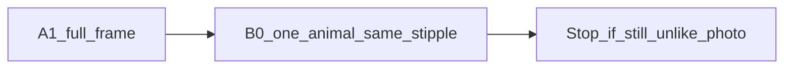

# 调研：动物照片绣成熟方案（停 A1 拧参）

**日期**：2026-11-14  
**背景**：B0 构图过关，观感仍是 A1 短针放大。人评指出黑舌、发灰、涂抹、偏淡、细节不足。下一刀改为商用叠色（方案 C），人像 V6.6 默认不动。  
**冻结**：动物 **不再**微调 A1（`dampen_warm_skin` / `animal_palette` / FG 结构 dens）；人像 V6.6 **不动**。

相关：[`路线-动物PhotoStitch.md`](路线-动物PhotoStitch.md) · [`路线-照片绣PhotoStitch.md`](路线-照片绣PhotoStitch.md) · [`调研-人像照片绣成熟方案.md`](调研-人像照片绣成熟方案.md)（人像可吸收清单；与本文分工见人像文 §4）

---

## 1. 命名纠偏（仓库旧文档易混）

| 名称 | 实际形态 | 勿与…混淆 |
|------|----------|-----------|
| **Hatch Color PhotoStitch** | 多线色叠层/混色写真 | PhotoFlash |
| **Hatch PhotoFlash** | 定向行扫（线打印机感） | Color PhotoStitch |
| **Brother Photo Stitch 1** | 多色叠层混色；Detail / Run Pitch；Image Type=Photo | Photo Stitch 2 |
| **Brother Photo Stitch 2** | 少色、各色不同方向直线，偏抽象 | Photo Stitch 1 |
| **Forge V6.6 dens** | Bayer/密度短针 **tonal stipple** | 不是真·Color PhotoStitch 叠层 |

此前路线文把「Wilcom Photo Flash」与「彩色照片绣」并称；动物轨应对齐 **Color PhotoStitch / PS1 目标观感**，算法族系上 Forge 更接近 **stipple**，不是 PhotoFlash 行扫。

---

## 2. 成熟族系一览

| 族系 | 代表 | 针迹形态 | 宠物场景常用点 | 与 Forge |
|------|------|----------|----------------|----------|
| Color PhotoStitch / PS1 | Hatch Color PhotoStitch；Brother PE-DESIGN Photo Stitch 1 | 多色**叠层混色**；Detail↑→重叠↑；Photo 模式混线 | 宠物写真主推；线程表匹配 | 目标同；Forge **无**真叠层混色 |
| PhotoFlash / PS2 | Hatch PhotoFlash；Brother Photo Stitch 2 | **定向行扫** / 分向直线 | 风格化；非毛丝理主解 | Forge **未实现** |
| Tonal stipple | [Boldbobbin Photostitch](https://docs.boldbobbin.com/how-to/auto-digitize-a-photo/) | 暗密亮疏；**stitches/mm²** 预算、Contrast、Fill floor、抠底 | 文档示例即单色狗肖像 | **同族**；开源/可试用天花板 |
| 方向场 streamlines | [embroidery-streamlines](https://github.com/desmondlzy/embroidery-streamlines)（CGF *Directionality-Aware Design*） | 密度场 + 方向场 → 连续流线 | 羽毛/毛发方向最对口 | **A2 已否决**（木纹/恐怖片感） |
| 产品预设 | InstaEmbroid Pet preset 等 | 流程：抠底、保眼神、裁头肩、8–12 色 | UX 预设，非算法核心 | 可抄流程，不抄闭源 |
| 其他开源套件 | OpenStitch（Rust/PE-DESIGN 向）、OpenStitch Studio、StitchFoundry | 各有 PhotoStitch / 行扫 / ML 宣称 | 成熟度参差；AGPL 等需注意 | 对照用，不整仓替换 |

### 宠物产品侧共识（非算法）

- 抠掉背景，只绣主体（或极疏背景）。  
- 裁到头肩，全身大场景性价比差。  
- 线色约 8–12；眼神高光要留。  
- 以密度/细节旋钮换针数，而不是无限抬分辨率。

### Boldbobbin 关键旋钮（同族对照）

| 旋钮 | 默认/含义 | Forge 现状 |
|------|-----------|------------|
| Density（stitches/mm²）或 Max stitches | 默认密度约 6 | **无**显式 mm² 预算；靠 step/max_side |
| Contrast | 影密亮疏拉伸 | dens gamma 隐式，无用户旋钮 |
| Fill floor | 高光区最低覆盖 | keep_floor 粗对应 |
| Working resolution | 默认 1024 px | max_side≈720 |
| Remove background | 准备步抠底 | `--bg keep` 动物默认保全帧 |
| Colors | 默认 5，宠物可 8–12 | `--colors 12` |

---

## 3. 与 Forge A1 的差距（为何拧参无效）

当前管线：[`embroideryforge/density_field.py`](../embroideryforge/density_field.py) Bayer 落点 + 压平色板分轨。

| 缺口 | 说明 |
|------|------|
| 无 stitches/mm² 预算 | 针数由网格 step 涌现，难与商用「密度」对话 |
| 无叠层混色 | 单像素一色，无 PS1 式多色重叠造中间调 |
| 无行扫 PhotoFlash | 无线方向打印机感 |
| 无毛发方向场 | A1 结构 dens 只抬暗部，**不是**丝理 |
| 色板遗产 | 人像暖肤逻辑曾污染动物；A1 已关，仍解决不了族系错配 |
| 多宠+场景 | `--bg keep` 保绿叶却稀释主体针预算 |

**结论**：A1 观感差是 **族系天花板 + 缺方向/叠层**，不是再拧 `protect_chroma` 能修的。

---

## 4. Bake-off 协议与本机结果

### 协议

| 项 | 值 |
|----|-----|
| 样例 | `samples/test_animal_02.jpg`（橘猫·色）、`samples/test_animal_04.jpg`（多宠·难） |
| Forge | `exports/photo_stitch_exp/animal_02_a1/`、`animal_04_a1/`（compare / thick） |
| 对照 | Boldbobbin Photostitch：抠底开、Colors 8–12、Density≈6、调 Contrast；截 Realistic + Stitch |
| 落盘 | `exports/photo_stitch_exp/bakeoff_mature/`（gitignore；文档只记路径） |
| 不要求 | 购买 Hatch / Brother；有截图可后补附录 |

### 判读规则

1. **Boldbobbin 明显好** → Forge 仍走 stipple；A2 = **预算化**（stitches/mm²、contrast、fill floor、工作分辨率、强制抠主体），不再加 dens_face 式补丁。  
2. **Boldbobbin 也糊 / 多宠翻车** → stipple 不够；A2 = **行扫原型** 或 **streamlines 单斑块**（二选一，见 §5）。

### 本机执行（2026-11-14）

| 检查 | 结果 |
|------|------|
| Boldbobbin / Hatch / PE-DESIGN / Wilcom 安装 | **未装**（`winget` / Program Files / LocalAppData 无匹配） |
| bakeoff 截图目录 | 未生成（阻塞于工具缺失） |
| Forge 侧 | `animal_02_a1`（309873 针）、`animal_04_a1`（358133 针）可作日后并排基准 |

未装不阻塞调研；装好后按协议补截图，并按判读规则 **覆写 §5 决策**（若与默认冲突）。

---

## 5. 决策：A2 流线人评否决（2026-11-15）

spike 已跑通，**观感否决**。`animal_02_a2_stream` 的 thick 是木纹/等高线，不像橘猫照片。原因：切向场沿局部边缘积分成长曲线，再整段缝上；连通域还把双猫和紫垫并成一块。

> 动物演示保持 **A1**。下一刀是方案 B：同一套短针，只绣一只动物。流线与密度预算都不作为默认。人像维持 V6.6。

---

## 6. 参考链接

- Boldbobbin Photostitch：https://docs.boldbobbin.com/how-to/auto-digitize-a-photo/  
- Brother Photo Stitch 1 参数：https://support.brother.com/g/s/hf/htmldoc/ped/im/ped11/en/PED11_EN/pages/06_1879551.html  
- Brother Photo Stitch 说明：https://sewingcraft.brother.eu/en/blog/embroidery/2024/photo-stitch-explained  
- Hatch Auto-Digitizing / Color PhotoStitch：https://hatchembroidery.com/products/hatch-embroidery/features/auto-digitizing  
- embroidery-streamlines：https://github.com/desmondlzy/embroidery-streamlines  
- CGF 方向性绣：https://doi.org/10.1111/cgf.14770  
